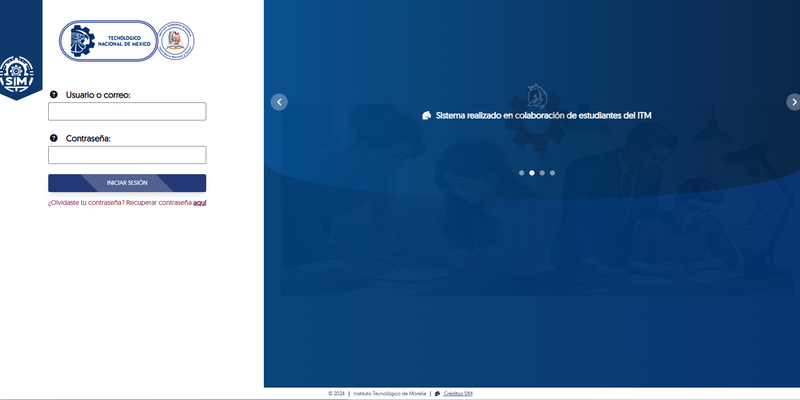
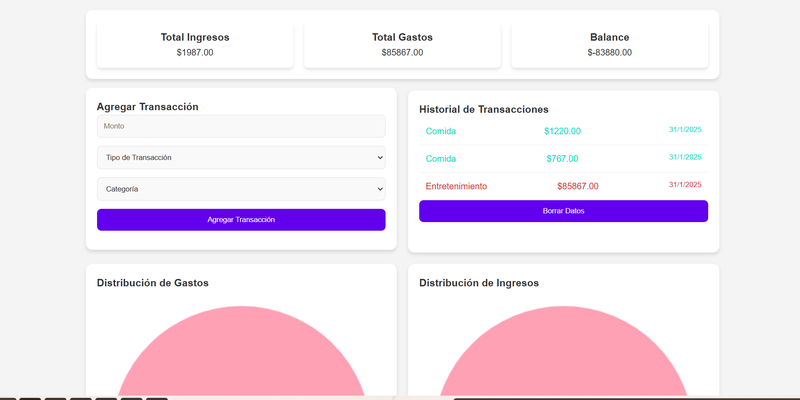
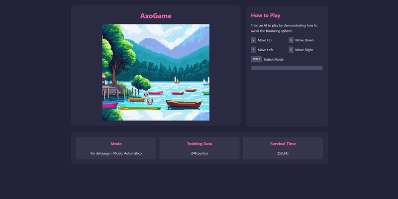

<h1>Alejandro Tenorio</h1>

  
  
  

📍 Morelia, Michoacán, México

---

## 👋 Sobre mí

Ingeniero en Sistemas Computacionales con especialidad en **Tecnologías en la Nube**. Trabajo en el desarrollo de **módulos para Odoo** y en la **administración de infraestructura en la nube**. Me interesa construir software que resuelva problemas reales de negocio y mantener entornos productivos confiables.

- 🔭 Desarrollando módulos personalizados de **Odoo** en Python para procesos de negocio.
- ☁️ Administrando despliegues en **AWS** con **Docker** y **Linux**.
- 🌱 Profundizando en arquitectura de contenedores y automatización de despliegues. <!-- TODO: sustituye por lo que estés aprendiendo ahora mismo -->
- 💬 Pregúntame sobre **Odoo**, **Python**, **infraestructura** o **ciencia de datos**.

---

## 📌 Proyectos

<table>
<tr>
<td width="50%" valign="top">

<h3 align="center">🎓 Módulo SIM — Eventos y Diplomas</h3>

Módulo de gestión de eventos y emisión de diplomas dentro del Sistema Integral Multiplataforma del TecNM campus Morelia. En producción.

  

<code>PHP</code> <code>MySQL</code> <code>JavaScript</code>

</td>
<td width="50%" valign="top">

<h3 align="center">💰 Finance Tracker JS</h3>

Aplicación web para el registro y control de finanzas personales, con cálculo de balances y categorización de movimientos.

  
  

<code>JavaScript</code> <code>HTML</code> <code>CSS</code>

</td>
</tr>
<tr>
<td width="50%" valign="top">

<h3 align="center">🕹️ Axo Game — Inteligencia Artificial</h3>

Juego cuyo agente aprende a jugar mediante técnicas de inteligencia artificial, entrenado directamente en el navegador.

  
  

<code>JavaScript</code> <code>IA</code>

</td>
<td width="50%" valign="top">

<h3 align="center">📈 House Pricing — EDA</h3>

Análisis exploratorio de datos sobre precios de vivienda: limpieza, correlaciones y visualización de los factores que determinan el precio.

  

<code>Python</code> <code>Pandas</code> <code>Jupyter</code>

</td>
</tr>
</table>

  

---

## 🛠 Stack

|  |  |
|:--|:--|
| **Lenguajes** |     |
| **Frameworks** |     |
| **Datos** |     |
| **Infraestructura** |     |

---

## 📊 Actividad

<picture>
  <source media="(prefers-color-scheme: dark)" srcset="https://github-readme-stats.vercel.app/api?username=AlejandroTenorioC&show_icons=true&include_all_commits=true&hide_border=true&title_color=714B67&icon_color=714B67&theme=github_dark">
  
</picture>
<picture>
  <source media="(prefers-color-scheme: dark)" srcset="https://github-readme-stats.vercel.app/api/top-langs/?username=AlejandroTenorioC&layout=compact&hide_border=true&title_color=714B67&theme=github_dark">
  
</picture>

<picture>
  <source media="(prefers-color-scheme: dark)" srcset="https://streak-stats.demolab.com/?user=AlejandroTenorioC&hide_border=true&ring=714B67&fire=714B67&currStreakLabel=714B67&theme=dark">
  
</picture>

<!--
  🐍 Animación de la serpiente de contribuciones.
  Descomenta el bloque de abajo DESPUÉS de ejecutar una vez el workflow
  .github/workflows/snake.yml desde la pestaña Actions del repositorio.
  Antes de eso la imagen todavía no existe y se vería rota.

  <picture>
    <source media="(prefers-color-scheme: dark)" srcset="https://raw.githubusercontent.com/AlejandroTenorioC/AlejandroTenorioC/output/github-snake-dark.svg">
    
  </picture>

-->

---

  Siempre abierto a nuevas oportunidades y colaboraciones.

